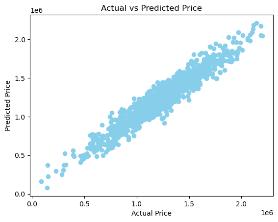
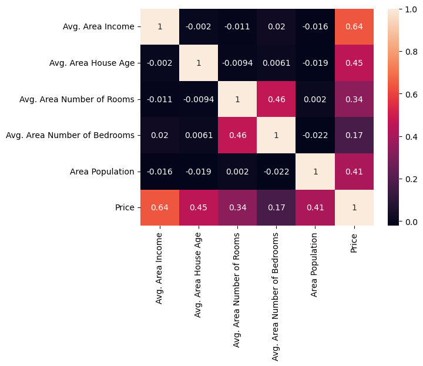
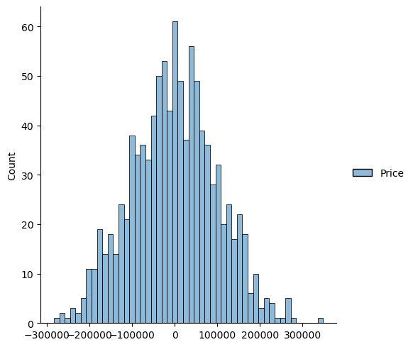

# House Price Prediction with Multiple Linear Regression

A multiple linear regression model that predicts house prices from five neighbourhood-level features,
with exploratory analysis, coefficient interpretation and evaluation on a held-out test set.



## Data
- `USA_Housing.csv`: **5,000 records**, a widely used **synthetic (simulated)** housing dataset for teaching
  regression. The addresses are generated placeholders, not real properties.
- **Target:** price (mean about $1.23M).
- **Features:** average area income, average house age, average number of rooms, average number of
  bedrooms and area population. The address column is not used.
- No missing values.

## Method
1. Exploratory analysis: pair plot, price distribution and correlation heatmap.
2. 80/20 train/test split (`random_state = 201`).
3. Linear regression with scikit-learn.
4. Coefficient interpretation.
5. Evaluation with MAE, MSE, RMSE and R², and a check of the residual distribution.

## Results
| Metric (test set) | Value |
|---|---|
| R² | **0.921** |
| MAE | $79,983 |
| RMSE | $100,141 |

**Coefficients** (change in price for a one-unit increase, holding the other features fixed):

| Feature | Coefficient |
|---|---|
| Avg. area income | +$21.56 per $1 of income |
| Avg. house age | +$166,378 per year |
| Avg. number of rooms | +$120,662 per room |
| Avg. number of bedrooms | +$2,929 per bedroom |
| Area population | +$15.23 per resident |



## Interpretation
- **Income** is the strongest single correlate of price (0.64), followed by house age (0.45) and population (0.41).
- **Bedrooms add little** once rooms are in the model: the two are correlated (0.46), so the room count
  already carries most of that information.
- An RMSE of about $100K is roughly 8% of the average price.
- Residuals are centred on zero and approximately normal, consistent with the assumptions of linear regression.
- Because the data are simulated with near-linear relationships, linear regression fits very well here. Real
  housing data would include location effects, non-linearities and outliers that this model does not capture.



## Next steps
- Compare with regularized models (Ridge, Lasso) and a tree-based model on a real housing dataset.
- Use cross-validation instead of a single train/test split.
- Check multicollinearity formally with variance inflation factors.

## How to run
```bash
pip install pandas numpy scikit-learn matplotlib seaborn
jupyter notebook "House Price prediction using Linear Regression.ipynb"
```

## Tools
Python · Pandas · NumPy · Scikit-learn · Matplotlib · Seaborn

---
Author: [Hafza Noor](https://github.com/hafzanoor)
